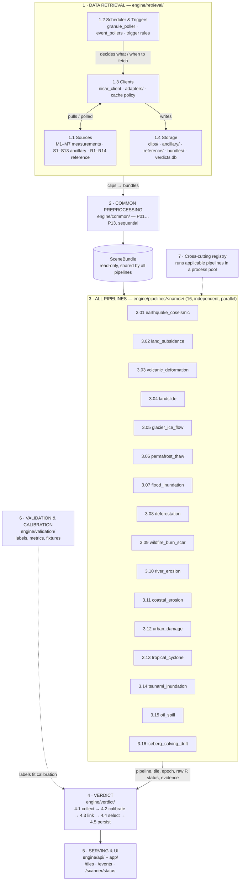

# nisar-hazard-engine

Global SAR (NISAR primary, Sentinel-1 fallback) hazard detection engine: retrieval → common preprocessing → 16 independent, parallel hazard pipelines → verdict → serving/UI, with validation and cross-cutting support.

Full design rationale, the current data-reality check, and the pipeline-by-pipeline open-source mapping live in [`docs/ARCHITECTURE.md`](docs/ARCHITECTURE.md). The diagram below is the same shape as `SARs_full_workflow.html`.

## Workflow



**Rules the diagram doesn't show but the folder structure enforces:** no pipeline ever reads another pipeline's verdict — shared logic only goes through `engine/lib/` (see `tests/test_pipeline_independence.py`). "Not applicable" is a distinct, valid result from "no event found."

### Common preprocessing chain (P01 → P13)

```mermaid
flowchart LR
    P01["P01<br/>granule<br/>resolution"] --> P02["P02<br/>clip"] --> P03["P03<br/>decode<br/>& gate"] --> P04["P04<br/>grid<br/>harmonization"] --> P05["P05<br/>geometry"] --> P06["P06<br/>phase<br/>to LOS"] --> P07["P07<br/>correction<br/>audit"] --> P08["P08<br/>backscatter<br/>prep"] --> P09["P09<br/>ancillary<br/>align"] --> P10["P10<br/>temporal<br/>stack"] --> P11["P11<br/>stable<br/>mask"] --> P12["P12<br/>tile quality<br/>+ routing"] --> P13["P13<br/>provenance"] --> SB[("SceneBundle")]
```



## Repo layout

Full tree with every file's purpose: [`docs/ARCHITECTURE.md` §3](docs/ARCHITECTURE.md#3-repository-layout). Top level:

```
engine/retrieval/   engine/common/   engine/lib/   engine/pipelines/*
engine/verdict/      engine/validation/   engine/api/   engine/registry.py
app/   data/   config/   docs/ARCHITECTURE.md
```
