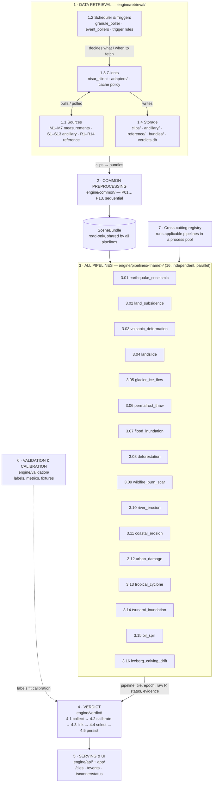

# nisar-hazard-engine

Global SAR (NISAR primary, Sentinel-1 fallback) hazard detection engine: retrieval → common preprocessing → 16 independent, parallel hazard pipelines → verdict → serving/UI, with validation and cross-cutting support.

Full design rationale, the current data-reality check, and the pipeline-by-pipeline open-source mapping live in [`docs/ARCHITECTURE.md`](docs/ARCHITECTURE.md). The diagram below is the same shape as `SARs_full_workflow.html`.

## Workflow

**Rules the diagram doesn't show but the folder structure enforces:** no pipeline ever reads another pipeline's verdict — shared logic only goes through `engine/lib/` (see `tests/test_pipeline_independence.py`). "Not applicable" is a distinct, valid result from "no event found."

### Common preprocessing chain (P01 → P13)

```mermaid
flowchart LR
    P01["P01<br/>granule<br/>resolution"] --> P02["P02<br/>clip"] --> P03["P03<br/>decode<br/>& gate"] --> P04["P04<br/>grid<br/>harmonization"] --> P05["P05<br/>geometry"] --> P06["P06<br/>phase<br/>to LOS"] --> P07["P07<br/>correction<br/>audit"] --> P08["P08<br/>backscatter<br/>prep"] --> P09["P09<br/>ancillary<br/>align"] --> P10["P10<br/>temporal<br/>stack"] --> P11["P11<br/>stable<br/>mask"] --> P12["P12<br/>tile quality<br/>+ routing"] --> P13["P13<br/>provenance"] --> SB[("SceneBundle")]
```

## Codebase map

What's actually in the repo, mapped onto the same 7 stages as the diagram above. Click a section to expand it — if a file's listed here, it exists in the repo at that path right now, nothing below is aspirational.

<b>1 · DATA RETRIEVAL</b> — <code>engine/retrieval/</code>

**scheduler/**

| File | Purpose |
|---|---|
| `granule_poller.py` | every 6h ASF/CMR query, diff vs ingested set |
| `triggers.py` | quake/storm/fire trigger rules → run list |
| `event_pollers/` | `comcat.py` · `firms.py` · `ibtracs.py` · `gfw.py` · `imerg.py` |

**clients/**

| File | Purpose |
|---|---|
| `nisar_client.py` | asf_search + HDF5 range-read clip |
| `sentinel1_client.py` | fallback sensor for ocean pipelines |
| `cache.py` | TTL disk cache, degraded-mode flag |
| `adapters/` | 14 files, one per R1–R14 reference source |

**sources/ & auth/**

| File | Purpose |
|---|---|
| `sources/` | static registry of M*/S*/R* definitions |
| `auth/secrets.py` | Earthdata login, CDS/FIRMS/GFW keys — centralized |

Writes to `data/clips/` · `ancillary/` · `reference/` · `bundles/` · `verdicts.db`.

<b>2 · COMMON PREPROCESSING</b> — <code>engine/common/</code> (P01…P13, sequential chain)

| File | Purpose |
|---|---|
| `p01_granule_resolution.py` | pair graph, track/frame/direction |
| `p02_clip.py` | tile + 1px margin, requested layers only |
| `p03_decode_gate.py` | fill→NaN, cc≥1 gate, float32 |
| `p04_grid_harmonization.py` | canonical grids G80/G20 |
| `p05_geometry.py` | LOS vector, incidence, layover/shadow |
| `p06_phase_to_los.py` | phase → displacement, per-pixel sigma |
| `p07_correction_audit.py` | records corrections, never applies silently |
| `p08_backscatter_prep.py` | gamma0 dB, HV/HH ratio |
| `p09_ancillary_align.py` | DEM → slope/aspect/HAND onto grids |
| `p10_temporal_stack.py` | epoch table, median/MAD, `cold_start` flag |
| `p11_stable_mask.py` | high coherence / low slope / non-water |
| `p12_tile_routing.py` | tile quality → applicable pipeline list |
| `p13_provenance.py` | checksums, param hash → bundle id |
| `scene_bundle.py` | the read-only object P01–P13 build |

`engine/lib/` sits beside this — `okada.py` · `flood_detect.py` · `offset_tracking.py` · `changepoint.py` · `terrain.py` — the **only** code any pipeline is allowed to import from another pipeline's problem domain.

<b>3 · ALL PIPELINES</b> — <code>engine/pipelines/&lt;name&gt;/</code> (16, independent, parallel)

Every folder has the same 8 files. Pipelines never import each other — only `engine/lib/`.

**example: `earthquake_coseismic/`**

| File | Purpose |
|---|---|
| `manifest.yaml` | applies/uses/own_prep/own_fetch/method/output, pre-filled from the spec |
| `prep.py` | far-field referencing, cycle-jump mask |
| `fetch.py` | R1 ComCat, R2 ShakeMap, S5 faults, R3 GNSS |
| `model.py` | Okada85 + optimizer, both nodal planes |
| `verdict.py` | returns P, status, evidence[] |
| `lib_local.py` | pipeline-only helpers, not shared |
| `tests/` | contract tests |
| `README.md` | human notes, generated from manifest |

**all 16 (+ `_template/` to copy for a new one)**

| # | Pipeline | Sensor | Core algorithm |
|---|---|---|---|
| 3.01 | `earthquake_coseismic` | NISAR | Okada85 |
| 3.02 | `land_subsidence` | NISAR | SBAS WLS |
| 3.03 | `volcanic_deformation` | NISAR | Mogi / dike |
| 3.04 | `landslide` | NISAR | stats + logistic prior |
| 3.05 | `glacier_ice_flow` | NISAR | offset tracking |
| 3.06 | `permafrost_thaw` | NISAR | seasonal regression |
| 3.07 | `flood_inundation` | NISAR | adaptive thresholds |
| 3.08 | `deforestation` | NISAR | CUSUM change detection |
| 3.09 | `wildfire_burn_scar` | NISAR | backscatter Δ |
| 3.10 | `river_erosion` | NISAR | bank-line transects |
| 3.11 | `coastal_erosion` | NISAR | waterline transects |
| 3.12 | `urban_damage` | NISAR | coherence damage proxy |
| 3.13 | `tropical_cyclone` | Sentinel-1 primary | eye/eyewall pattern |
| 3.14 | `tsunami_inundation` | NISAR | reuses `engine/lib/` (3.01 + 3.07) |
| 3.15 | `oil_spill` | Sentinel-1 primary | CFAR dark-spot |
| 3.16 | `iceberg_calving_drift` | NISAR or Sentinel-1 | CFAR + tracking |
| — | `_template/` | — | copy me for a 17th |

<b>4 · VERDICT</b> — <code>engine/verdict/</code> (4.1 → 4.5)

| File | Purpose |
|---|---|
| `collect.py` | 4.1 gathers every pipeline's return fields |
| `calibrate.py` | 4.2 isotonic/Platt once labels exist, else status tiers |
| `link_events.py` | 4.3 quake→landslide→tsunami→urban; exclusivity groups |
| `select.py` | 4.4 best verdict per tile, abstain if below threshold |
| `persist.py` | 4.5 verdicts.db + GeoJSON/COG layers |

<b>5 · SERVING &amp; UI</b> — <code>engine/api/</code> + <code>app/</code>

| File | Purpose |
|---|---|
| `api/main.py` | FastAPI entrypoint |
| `api/routes_tiles.py` | `/tiles`, `/tiles/:id/verdicts` |
| `api/routes_pipelines.py` | `/pipelines` — drawer built from manifests |
| `api/routes_events.py` | `/events` — linked events from 4.3 |
| `api/routes_scanner.py` | `/scanner/status` |
| `api/routes_datasets.py` | `/datasets` |
| `app/` | existing Next.js — map, panel, time slider |

<b>6 · VALIDATION &amp; CALIBRATION</b> — <code>engine/validation/</code> (supporting, not in the data flow)

| File | Purpose |
|---|---|
| `labels.py` | ComCat, FIRMS, GFW, DFO/EMS, COOLR, GNSS… |
| `metrics.py` | stratified F1, precision-recall, Brier, false-alarm rate |
| `fixtures/` | seeded synthetic scenes per hazard + null scene |

<b>7 · CROSS-CUTTING</b> — <code>engine/registry.py</code> + top-level <code>tests/</code>

| File | Purpose |
|---|---|
| `engine/registry.py` | scans `pipelines/*`, reads manifests, runs applicable ones in a process pool |
| `tests/test_pipeline_independence.py` | static check: no cross-pipeline imports |
| `tests/test_scene_bundle_contract.py` | fields every pipeline can rely on |
| `tests/test_common_truth.py` | engine/common against analytic truth (terrain, HAND, UTM zones, fills, ramps) |
| `tools/debug_hub/` | **unified local debug layer** (`python tools/hub.py`): DATA RETRIEVAL · HEALTH · DATA PROCESSING, live over the real engine path, see `tools/debug_hub/README.md` |
| `tools/sar_debug/` | standalone HTML debug report for retrieval, files and the engine checkout (`cd tools && python -m sar_debug --demo`); engine-independent by design |
| `config/tiling.yaml` | grid scheme — still an open decision, see docs |
| `docs/ARCHITECTURE.md` | full vision, data-reality check, OSS library map |

